<!-- ====================== HEADER ====================== -->

  

  

  

  
  
  
  

##  About Me

<table>
<tr>
<td width="62%" valign="top">

**A passionate Java Full Stack Developer from India 🇮🇳**

| Quick Facts | |
|---|---|
| 🔭 **Working on** | Food Delivery App 🍔 |
| 🌱 **Learning** | Java in depth ☕ |
| 👯 **Collaborating on** | Food Delivery App |
| 💬 **Ask me about** | Java · Spring Boot · React · MySQL |
| 📫 **Reach me** | [itizzakir@gmail.com](mailto:itizzakir@gmail.com) |
| 😄 **Call me** | Zaky |
| ⚡ **Fun fact** | Programmers don't sleep; they just debug in their dreams 🌙💭 |

> 🤔 *Curiosity is your greatest skill — keep it alive.*

</td>
<td width="38%" align="center">
  
</td>
</tr>
</table>

## 🛠️ Tech Stack

  

<b>☕ Backend</b>

<b>🎨 Frontend</b>

<b>⚙️ Tools, Cloud &amp; Other Languages</b>

  
  
  

## 📊 GitHub Analytics

  

### 🐍 Contribution Snake

  <picture>
    <source media="(prefers-color-scheme: dark)" srcset="https://raw.githubusercontent.com/itizzakir/itizzakir/output/github-contribution-grid-snake-dark.svg" />
    <source media="(prefers-color-scheme: light)" srcset="https://raw.githubusercontent.com/itizzakir/itizzakir/output/github-contribution-grid-snake.svg" />
    
  </picture>

### ✍️ Random Dev Quote

  

## 🌐 Let's Connect

  
  
  
  
  
  

  

<!-- ====================== FOOTER ====================== -->

  

